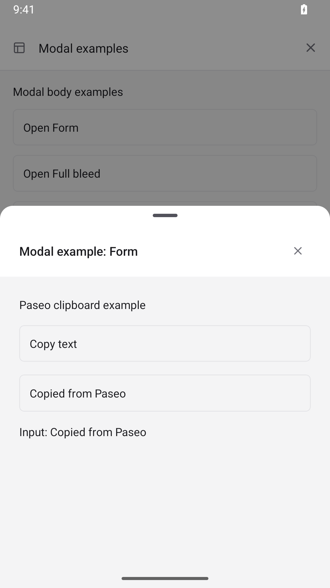
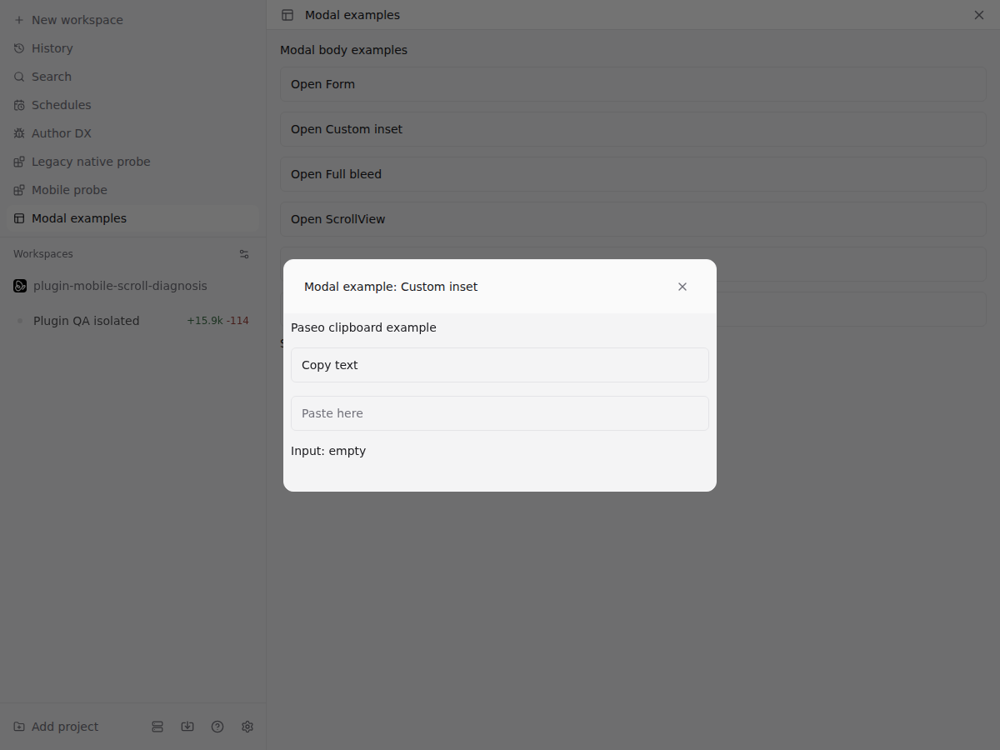
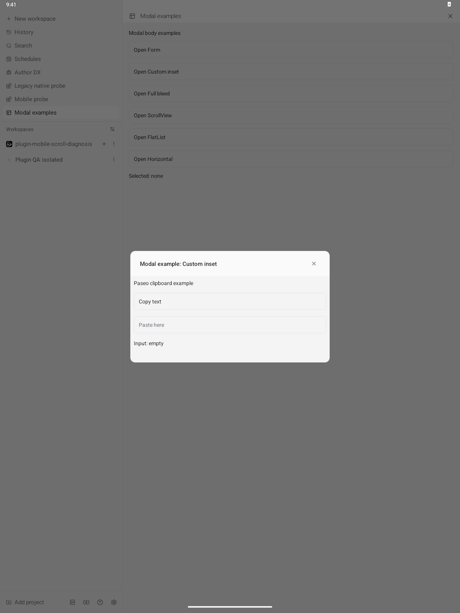

# Modal UI example

From the Pimi checkout on the host, install the example directory.

```sh
pimi plugin install "$(pwd)/plugin-examples/modal-ui"
```

You can also paste the absolute directory path into **Plugin source** under **Settings → Plugins**.
Enable plugins, then open **Modal examples** from the sidebar or a workspace tab.
Choose **Open Form**, type into **Paste here**, and watch the **Input:** text update.
The installed plugin ID is `modal-ui-example`.

Pimi compiles the TypeScript sources through its directory plugin loader and supplies React,
React Native, and `@pimi/plugin`. See the [plugin reference](https://github.com/1ikeadragon/pimi-releases/blob/main/docs/plugins/reference.md)
for supported sources and preparation rules.

The examples demonstrate default and custom padding, a full-width body, author-owned ScrollView and
FlatList scrolling, horizontal tabs, and clipboard actions with a keyboard-aware input.

The browser regression installs this exact example in an isolated daemon:

```sh
cd packages/app
npx playwright test e2e/browser/plugin-modal-body.spec.ts --project=browser --workers=1
```

On Android, open each example and drag up on its content to expand the sheet, then scroll the list.
In FlatList, expand before using **Jump to last row**; row 100 should be visible. At the top of either
list, drag down on a row to dismiss the sheet. In Form,
press **Copy text**, long-press the input, and choose **Paste**. The input should contain
“Copied from Pimi”. With the system keyboard enabled, focusing the input should keep it visible.

Run the native sheet regression to check body
dismissal, list scrolling and horizontal tabs together.

These captures show Android copy/paste and custom padding on browser and wide native layouts.
Android API 35 and Chromium were exercised; iOS and Electron were not tested.

| Android copy/paste                                               | Browser custom padding                                      | Wide Android custom padding                                               |
| ---------------------------------------------------------------- | ----------------------------------------------------------- | ------------------------------------------------------------------------- |
|  |  |  |
